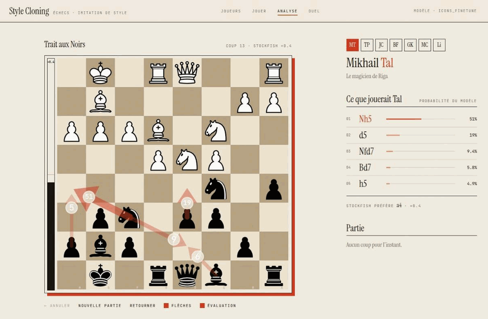

# Chess Style Cloning

Un bot d'échecs qui imite, au choix, le style de plusieurs joueurs iconiques (Tal, Petrossian, Carlsen…), par behavioral cloning avec PyTorch.
Livrable : une démo jouable avec les probabilités de coups affichées sur l'échiquier, et un benchmark qui mesure la différence de style.

**Résultat** : un ResNet conditionné par un embedding de joueur, pré-entraîné sur Lichess puis ajusté sur 6 grands maîtres, prédit le coup réel avec **39,3 %** de top-1 (hors ouverture) et 67,8 % de top-3, contre 37,4 % pour le modèle Lichess seul. Le conditionnement par joueur se mesure à environ +0,6 point ; le benchmark de style est détaillé dans [Résultats](#résultats).

Plan de projet complet (vision, tâches par rôle, planning) : https://claude.ai/artifact/VpVWEHbMFxdTUavUfF3bGG

## Démo



Est-indienne, coup 13, trait aux Noirs. Le modèle conditionné sur Tal joue l'attaque **Cf6-h5** (51 %, contre 12 % pour Petrosian) ; conditionné sur Petrosian, il préfère le regroupement **Cf6-d7** (48 %, contre 9 % pour Tal). En mode Duel, les six joueurs se répartissent en trois coups : Ch5 pour Tal et Fischer, Cfd7 pour Petrosian et Capablanca, d5 pour Kasparov et Carlsen.

Cette position est choisie : c'est celle où Tal et Petrosian divergent le plus parmi 400 positions de milieu de partie tirées au hasard (distance de variation totale 0,44, médiane 0,14). Dans une position typique, les distributions sont bien plus proches (voir [Limites](#limites)).

[Ouvrir cette position dans l'appli](http://127.0.0.1:8000/?vue=analyse&fen=r1bqr1k1/1p3pbp/2pp1np1/p1n5/2PNP3/2N1BPPP/PP4B1/R2QR1K1%20b%20-%20-%201%2013) (serveur lancé en local, voir [Appli de démo](#appli-de-démo)).

## Le modèle

- **Entrée** : 18 plans 8×8 vus du côté du joueur qui a le trait, **sortie** : 4 672 logits (73 types de coups × 64 cases), masqués aux coups légaux (contrat : `docs/CONTRACT.md`).
- **Réseau** : convolution d'entrée, 8 blocs résiduels de 128 filtres (BatchNorm, ReLU), tête de politique 1×1 à 73 canaux. 2,5 M de paramètres.
- **Joueur** : un `nn.Embedding` module chaque bloc par un gain et un biais par canal (FiLM). L'identifiant 0 est le modèle générique (Lichess).
- **Entraînement** : cross-entropy sur les coups légaux, AdamW, mixed precision, learning rate cosine, on garde le meilleur modèle sur le top-1 de validation. Pré-entraînement sur Lichess Elite (identifiant 0), puis fine-tune sur les joueurs iconiques avec leur identifiant.

## Installation

```bash
python -m venv .venv && source .venv/bin/activate
pip install -r requirements.txt
sudo apt install stockfish
wandb login
pytest -q
```

Sous Windows : `.venv\Scripts\activate` à la place de `source`, et Stockfish via `winget install Stockfish.Stockfish` (ou le binaire de stockfishchess.org, ajouté au `PATH`).

## Évaluation

```bash
python -m chessstyle.evaluate runs/latest data/processed/icons/test.h5 --out runs/latest/eval_icons.json
```

Affiche le top-1 et le top-3 par joueur et par phase de jeu, puis la matrice croisée : le modèle conditionné sur le joueur i (ligne), évalué sur les vrais coups du joueur j (colonne). Si les styles sont appris, la diagonale est la meilleure de chaque colonne. Les coups 1 à 10 sont mesurés à part. `--wandb PROJET` envoie aussi les chiffres sur W&B.

## Travail de machine learning

Projet mené à deux (rôle 1 : données brutes, modèle, entraînement ; rôle 2 : jeu de données, évaluation, appli), avec un contrat d'interface commun et des PR relues.

1. **Contrat d'interface** (`docs/CONTRACT.md`) : encodage des positions et des coups figé et versionné, testé sur des exemples de référence (le coup `e2e4` donne l'indice 76 pour les deux camps grâce au miroir des Noirs).
2. **Données** : filtrage des PGN (Lichess Elite à cadence rapide ou lente, PGN Mentor pour les six joueurs) vers Parquet, puis HDF5 découpé 90/5/5 **par partie** pour éviter toute fuite entre train et test. Lecture par morceaux avec un buffer de mélange, sans tout charger en mémoire.
3. **Modèle** : ResNet 8×128 avec embedding de joueur et FiLM dans chaque bloc. Validation par un test de sanité : le réseau doit surapprendre 1 000 positions.
4. **Pré-entraînement** sur Lichess (Kaggle, GPU). Le premier essai surapprenait (le top-1 de validation retombait d'environ 45 % à 43,9 %) : ajout de la sauvegarde du meilleur modèle, d'un learning rate cosine et d'un weight decay plus fort, ce qui a donné 45,5 %.
5. **Fine-tune** sur les joueurs iconiques à partir du modèle Lichess, avec leur identifiant.
6. **Évaluation** : top-k par joueur et par phase de jeu, matrice croisée « modèle conditionné sur i, évalué sur j », et benchmark de style avec Stockfish (captures, échecs, coups de pion/dame/roi, perte en centipions).
7. **Variante testée** : époques équilibrées par joueur avec 20 % de positions Lichess. Elle n'a pas amélioré le résultat (38,6 % contre 39,3 %), on a donc gardé le fine-tune simple.
8. **Contrôle des chiffres** : la comparaison avec le modèle Lichess seul se fait avec l'identifiant générique des deux côtés, pour ne pas gonfler le gain.

## Déploiement

Du modèle entraîné à une démo jouable.

- **Artefacts d'un entraînement** : un dossier avec `model.pt` (poids), `config.yaml` (architecture et `encoding_version`) et `players.json` (liste figée des joueurs). Le chargement de `evaluate.py` vérifie la version d'encodage et refuse un modèle incompatible. Les poids ne sont pas dans Git (`data/` et `*.pt` sont ignorés).
- **Entraînement sur GPU** : pré-entraînement et fine-tune lancés sur Kaggle à partir du dépôt, avec les fichiers HDF5 dans un dataset privé.
- **Modèle factice pour avancer en parallèle** : `python -m chessstyle.model` exporte un TorchScript aux poids aléatoires (`dummy_model.pt`, signature `(board, player_id) → logits`). L'appli a été développée avec lui avant la fin de l'entraînement ; elle se branche ensuite sur le vrai dossier de run.
- **Inférence** (`inference.py`) : pour une position et un ou plusieurs joueurs, distribution des probabilités sur les coups légaux, triés. Le même code lit un dossier de run ou un TorchScript.
- **API** (`server.py`, FastAPI) : `GET /api/info` (joueurs et modèle chargé), `POST /api/predict` (FEN + joueurs → coups et probabilités), `POST /api/eval` (évaluation Stockfish).
- **Interface** (`app/`, React + Vite + chessground) : échiquier, barres de probabilité des coups par joueur, comparaison côte à côte, profil du joueur, barre d'évaluation Stockfish.
- **Intégration continue** : GitHub Actions lance les tests (`pytest`) sur chaque PR, avec PyTorch CPU.

```bash
cd app && npm install && npm run build      # compile l'interface dans app/dist
python -m chessstyle.server --model runs/icons_finetune    # API + interface sur http://127.0.0.1:8000
```

L'appli est sur la branche `feat/app` (pas encore fusionnée dans `main`) ; il n'y a pas d'hébergement en ligne pour l'instant.

## Résultats

Données : Lichess Elite 2024-01 (cadence rapide ou plus lente), 2,16 M de positions ; PGN Mentor pour Tal, Petrosian, Capablanca, Fischer, Kasparov et Carlsen, 582 k positions (de 21 k pour Capablanca à 268 k pour Carlsen en entraînement). Split 90/5/5 par partie, jamais par position.

**Pré-entraînement (Lichess)** : top-1 de validation 45,5 % (meilleure époque : la 8e sur 10). Au-delà, le modèle surapprend.

**Fine-tune sur les joueurs iconiques**, jeu de test de 23 344 positions hors ouverture (coups 1 à 10 exclus), mesuré avec `evaluate.py` :

| Modèle | Top-1 | Top-3 |
| --- | --- | --- |
| Pré-entraîné Lichess, identifiant générique | 37,4 % | 65,7 % |
| Fine-tune, identifiant générique | 38,6 % | 67,2 % |
| Fine-tune, vrai joueur | **39,3 %** | **67,8 %** |

Le gain total est d'environ **+1,9 point** de top-1 (+2,1 de top-3) : +1,3 vient de l'adaptation aux données des maîtres, **+0,6** du conditionnement par joueur. Ces moyennes sont pondérées par le nombre de positions de chaque joueur (calculées à partir de la matrice croisée).

**Style (`style_bench.py`)**, 300 positions par joueur, Stockfish profondeur 10 : le modèle conditionné est plus proche du profil réel du joueur (parts de captures, échecs, coups de pion, dame, roi) que le modèle générique pour **1 joueur sur 6**. La perte moyenne face à Stockfish est de 18 à 28 centipions pour les vrais coups, et de 79 à 118 pour le coup préféré du modèle, conditionné ou non.

## Limites

- **Effet du joueur encore faible** : avec ces données, le modèle utilise peu l'identifiant (la diagonale de la matrice croisée est la meilleure de sa colonne dans 1 cas sur 6).
- **Données** : de 21 k (Capablanca) à 268 k (Carlsen) positions, et quelques centaines à quelques milliers de positions de test par joueur, donc des écarts d'un à deux points restent dans le bruit.
- **Modèle** : il ne voit que la position, sans l'historique des coups, et surapprend vite au fine-tune (on garde le meilleur modèle).
- **Pistes** : plus de données par joueur, geler le tronc pour n'entraîner que les embeddings, mesurer les sacrifices.

## Compétences mobilisées

- **Deep learning (PyTorch)** : architecture sur mesure (ResNet, FiLM, tête de politique à 4 672 classes), masque des coups illégaux, mixed precision, learning rate cosine, fine-tune à partir d'un checkpoint, entraînement sur GPU (Kaggle).
- **Données** : pipeline PGN → Parquet → HDF5, split sans fuite par partie, DataLoader par morceaux avec mélange en buffer, échantillonnage équilibré par joueur.
- **Évaluation et diagnostic** : métriques par joueur et par phase, matrice croisée, benchmark de style avec Stockfish, détection du surapprentissage, vérification des références de comparaison.
- **Génie logiciel** : contrat d'interface versionné, tests automatisés (pytest), intégration continue GitHub Actions, PR relues, journal de décisions (`docs/DECISIONS.md`).
- **Déploiement** : export TorchScript, chargement versionné des artefacts, API FastAPI, interface React/TypeScript, intégration continue.
- **Outils** : python-chess, Stockfish, h5py/pandas, Kaggle, Git/GitHub, W&B (journalisation optionnelle).

## Reproduire

Les données et les poids ne sont pas dans Git (`data/` est ignoré). Le fine-tune final a tourné sur Kaggle (GPU).

```bash
# 1. PGN -> Parquet -> HDF5 (split par partie)
python -m chessstyle.ingest lichess data/raw/elite.pgn.zst -o data/interim/lichess.parquet
python -m chessstyle.ingest icons data/raw/Tal.pgn data/raw/Petrosian.pgn data/raw/Capablanca.pgn data/raw/Fischer.pgn data/raw/Kasparov.pgn data/raw/Carlsen.pgn -o data/interim/icons.parquet
python -m chessstyle.build_dataset data/interim/lichess.parquet -o data/processed/lichess
python -m chessstyle.build_dataset data/interim/icons.parquet -o data/processed/icons

# 2. Pré-entraînement Lichess, puis fine-tune iconique
python -m chessstyle.train data/processed/lichess/train.h5 --val data/processed/lichess/val.h5 --workers 2 --batch-size 512 --epochs 10 --weight-decay 0.05 --out runs/lichess_pretrain
python -m chessstyle.train data/processed/icons/train.h5 --val data/processed/icons/val.h5 --init runs/lichess_pretrain --lr 3e-4 --weight-decay 0.05 --epochs 6 --batch-size 512 --out runs/icons_finetune

# 3. Mesures
python -m chessstyle.evaluate runs/icons_finetune data/processed/icons/test.h5 --out runs/icons_finetune/eval.json
python -m chessstyle.style_bench runs/icons_finetune data/processed/icons/test.h5 --out runs/icons_finetune/style.json
```

`train.py` accepte aussi `--balance N` et `--mix-h5` (époques équilibrées par joueur avec une part de Lichess) et `--patience N` (arrêt anticipé).

## Structure

```
src/chessstyle/
├── game.py           # interface Game générique
├── encoding.py       # ChessGame : le contrat (voir docs/CONTRACT.md)
├── players.py        # liste figée des joueurs imités
├── ingest.py         # rôle 1 : PGN -> parties filtrées
├── build_dataset.py  # rôle 2 : parties -> HDF5
├── dataset.py        # rôle 2 : DataLoader
├── model.py          # rôle 1 : ResNet conditionné par le joueur
├── train.py          # rôle 1 : pré-entraînement et fine-tune
├── evaluate.py       # rôle 2 : top-k, matrice croisée
├── style_bench.py    # rôle 2 : métriques de style Stockfish
├── inference.py      # rôle 2 : distribution des coups d'une position, par joueur
└── server.py         # rôle 2 : API FastAPI de l'appli
app/       # rôle 2 : interface React (chessground), modes Analyse, Jouer, Duel
configs/   tests/   docs/   data/ et runs/ (ignorés par Git)
```

## Appli de démo

Il faut Node.js 22 ou plus récent.

```bash
cd app && npm ci && npm run build && cd ..
PYTHONPATH=src python -m chessstyle.server --model models/icons_finetune     # http://127.0.0.1:8000
```

`--model` accepte un dossier de run de `train.py` (comme `models/icons_finetune` : poids, `config.yaml`, `players.json`) ou un fichier TorchScript (`python -m chessstyle.model` crée `dummy_model.pt`). Sans `--model`, les poids sont aléatoires.
Pour ouvrir directement une position : `http://127.0.0.1:8000/?vue=analyse&fen=...` (`vue` vaut `joueurs`, `jouer`, `analyse` ou `duel`).
La barre d'évaluation utilise Stockfish s'il est installé (`sudo apt install stockfish`, ou `--stockfish CHEMIN`) ; sinon elle est masquée.
Pour développer l'interface avec rechargement à chaud : lancer le serveur, puis `cd app && npm run dev` (http://localhost:5173, les appels `/api` partent vers le port 8000).

## Règles

- `main` ne reçoit que des PR relues par l'autre, avec la CI verte.
- Une branche par issue : `feat/...`, `fix/...`.
- `encoding.py` ne change qu'avec l'accord des deux et une nouvelle `ENCODING_VERSION`.
- Les décisions vont dans `docs/DECISIONS.md`.
